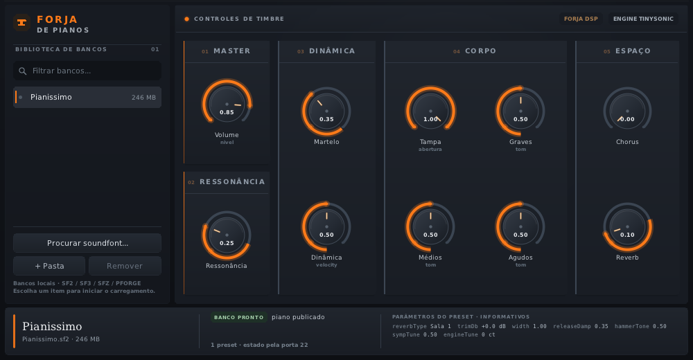

# PianoForge

**PT** — O PianoForge não é mais uma biblioteca de piano: ele pega o piano que você
já tem em soundfont (`.sf2`, `.sf3`, `.sfz` ou um `.pforge` com SF2 dentro), **melhora**
o ataque com martelo e curva de dinâmica, **molda** o corpo com EQ de tábua, tampa e
graves/médios/agudos, e **enriquece** o espaço com ressonância simpática, chorus e
reverb. Tudo num painel desenhado do zero em "forja de pianos", com o mesmo motor no
LV2 e no VST3.

**EN** — PianoForge is not another sampled piano: it takes the piano you already have
as a soundfont (`.sf2`, `.sf3`, `.sfz`, or a `.pforge` carrying an SF2), **improves**
the attack with a hammer transient and a velocity curve, **shapes** the body with
soundboard EQ, lid and low/mid/high trims, and **enriches** the space with sympathetic
resonance, chorus and reverb. One engine behind LV2 and VST3, one hand-drawn dark UI.



*O painel atual, capturado da janela Win32 real: à esquerda os bancos que o usuário
registrou (só o caminho, nenhum som no repositório), à direita os dez knobs da cadeia
de timbre, e no rodapé o estado do worker (`BANCO PRONTO`) e os parâmetros do preset.*

---

## O caminho do som: soundfont → MIDI → processamento → áudio

O plugin não traz amostras: ele é a forja por onde passa um piano que você já tem.

1. **Soundfont.** Você registra um `.sf2`, `.sf3`, `.sfz` ou `.pforge`; o arquivo fica
   onde está — a lista guarda o caminho, nunca uma cópia. O worker do host carrega o
   banco fora da thread de áudio. SF2 toca pelo TinySoundFont vendorizado (e um SF2
   dentro de `.pforge` também); `.sfz` e `.sf3` passam pelo sfizz, que precisa estar
   instalado — sem ele são recusados com uma frase e o resto continua funcionando.
2. **MIDI.** O host entrega notas, pedal e bend com o tempo do bloco (LV2 por
   `atom:Sequence` + `lv2:worker`, VST3 por `IEventList`). O engine ordena por
   `delayFrames`, fatia o bloco nas fronteiras dos eventos e aplica a curva de dinâmica
   à velocidade antes de disparar a nota.
3. **Processamento.** Cada fatia passa pela cadeia nesta ordem: amostra do backend →
   transiente de martelo → ressonância simpática → EQ de tábua (graves/médios/agudos) →
   filtro de tampa → chorus estéreo → reverb de concerto → master (largura, trim,
   volume e soft clip). Os dez knobs do painel são essas portas, suavizadas por bloco.
4. **Áudio.** Duas saídas estéreo para o host. No standalone, o mesmo engine renderiza
   para WAV (`-o arquivo.wav`); tocar ao vivo pela placa (`--live`) existe no Linux
   (ALSA) e no macOS (CoreAudio) — no Windows o standalone só renderiza arquivo.

---

## As duas regras que mandam no plugin

1. **Nada é carregado sozinho.** O plugin nasce mudo: `instantiate()` não toca disco
   nenhum, e um valor que o host *restaure* de uma sessão salva não dispara load.
   Você escolhe o piano, e a escolha acontece fora da thread de áudio.
2. **A lista só tem o que você registrou — e na primeira execução ela está vazia.**
   Um caminho absoluto por linha, ordem de inserção preservada, em
   `~/.config/pianoforge/soundfonts.list` (Linux e macOS) ou
   `%APPDATA%\pianoforge\soundfonts.list` (Windows) — `XDG_CONFIG_HOME` manda quando
   existe, e é com ele que os testes montam um registro de mentira. Não há varredura
   de pasta e não há soundfont dentro do bundle do plugin.

Consequência aceita, e deliberada: **uma sessão salva abre muda até você escolher de
novo.**

## Build

```sh
cmake -B build -DCMAKE_BUILD_TYPE=Release
cmake --build build
```

Isso produz `build/pianoforge.lv2/` (o plugin, a UI e as fontes) e os binários de
verificação em `build/`. Requisitos: CMake ≥ 3.16, compilador C++17.

Num gerador multi-config — o Visual Studio, que é o default do CMake no Windows — os
executáveis caem em `build/Release/` e o build precisa do `--config`:

```sh
cmake -S . -B build -DCMAKE_BUILD_TYPE=Release
cmake --build build --config Release
```

O bundle continua em `build/pianoforge.lv2/` e o `.vst3` em `build/vst3/` nos dois
casos: o caminho do bundle é o mesmo nos geradores, e é dele que o CI empacota.

### Windows: MSVC e MinGW

Os dois toolchains são suportados. O release oficial usa MSVC (o gerador default do
CMake no Windows); o MinGW-w64 é o que esta árvore foi construída e testada no
desenvolvimento.

- **MSVC**: os fontes são UTF-8 com acento, então o configure liga `/utf-8` (sem isso
  o literal sai mojibake na janela do host). Os harnesses incluem `<windows.h>` com
  `NOMINMAX`, porque as macros `min`/`max` do SDK quebram `std::min`/`std::max`.
- **MinGW-w64**: o runtime vai estático (`-static`). Sem isso o `pianoforge.dll`
  importa `libstdc++-6.dll`, `libgcc_s_seh-1.dll` e `libwinpthread-1.dll`, que não
  existem na máquina de quem usa o plugin — o host falha no `LoadLibrary` com "módulo
  não encontrado", longe do build. Com `-static`, as únicas importações são DLLs do
  próprio Windows.

O mesmo build monta `build/vst3/PianoForge.vst3/` — **se** o SDK do VST3 estiver no
lugar. Ele não é vendorizado (são ~40 MB de cabeçalho e helper que o histórico deste
repo não precisa carregar; a licença, essa, é MIT como aqui: ver `NOTICE`), então o
passo zero é buscá-lo:

```sh
scripts/get_vst3sdk.sh                # Linux, macOS, ou Git Bash no Windows
scripts/get_vst3sdk.ps1               # Windows (PowerShell)
```

Sem essa pasta o configure avisa e o build segue só com LV2 — nada quebra. Para pular
o shell VST3 de propósito: `-DPF_VST3=OFF`.

| Dependência | Para quê | Sem ela |
|---|---|---|
| sfizz (opcional) | backend `.sfz` / `.sf3` | o plugin continua tocando `.sf2` e `.pforge` com SF2 dentro |
| X11 (só Linux) | a janela da UI | o plugin carrega mudo, sem painel |

No Windows e no macOS a janela não depende de nada de terceiro: GDI+User32 e Cocoa vêm
com o sistema, e o painel por baixo deles é o mesmo `drawPanel()` portável.

Para apontar um sfizz instalado fora do caminho padrão: `-DSFIZZ_DIR=/prefixo`.

### Instalando no host

```sh
# LV2
cp -r build/pianoforge.lv2 ~/.lv2/                                # Linux
cp -r build/pianoforge.lv2 ~/Library/Audio/Plug-Ins/LV2/          # macOS
# Windows: copie pianoforge.lv2 para %LOCALAPPDATA%\Programs\Common\LV2\

# VST3
cp -r build/vst3/PianoForge.vst3 ~/.vst3/                         # Linux
cp -r build/vst3/PianoForge.vst3 ~/Library/Audio/Plug-Ins/VST3/   # macOS
# Windows: copie PianoForge.vst3 para %LOCALAPPDATA%\Programs\Common\VST3\
```

As duas pastas carregam o mesmo motor e o mesmo painel: não há recurso de um formato
que falte no outro. `PianoForge.vst3` é uma pasta, não um arquivo — copie inteira, com
`Contents/Resources/` (as fontes) dentro.

## Usando

Abra o PianoForge num host — o LV2 no Carla/Jalv, o `.vst3` no REAPER/Cubase/Bitwig —
clique em **Procurar soundfont…** e escolha um `.sf2`, `.sf3`, `.sfz` ou `.pforge`. O
rodapé lê `FORJANDO` enquanto o worker carrega e `piano na forja`/`BANCO PRONTO` quando
o banco está no ar. Antes disso, silêncio — é a regra 1.

Registrar não copia nada: o caminho do soundfont entra na lista e o arquivo continua
onde estava, inclusive num diretório que o repositório ignora (`.sf2`, `.sf3`, `.sfz` e
`.pforge` nunca são versionados aqui). A lista é sua: mover ou apagar o arquivo deixa a
linha apontando para o vazio, e o painel avisa que o arquivo não abriu — o piano
anterior continua soando.

Os dez knobs são volume, curva de dinâmica, ataque do martelo, tampa, graves/médios/
agudos, ressonância simpática, chorus e reverb. Arraste na vertical, `Shift` para
ajuste fino, duplo clique restaura o default da porta, roda do mouse sobre o knob ou
sobre a pílula de preset.

## O que há neste repositório

```
src/core/          engine, Bank (SF2/SFZ/bundle), DSP, leitor .pforge, fontes da UI
src/lv2/           wrapper LV2: 24 portas, lv2:worker, duas saídas de estado
src/vst3/          o mesmo plugin como VST3: factory, componente+processador+editor
                   num objeto, IPlugView com o painel de sempre
src/ui/            a janela (X11 / Win32 / Cocoa) sobre o painel portável
src/core/ui/       Surface ARGB, fonte stb_truetype, drawPanel() — sem dependência de SO
src/standalone/    render roteirizado, --live na placa (ALSA/CoreAudio) e teclado MIDI
packaging/         bundle.py (empacotador .pforge) + fixture de teste
tools/             os cinco harnesses de verificação, abaixo
third_party/       miniz, stb, headers LV2 (vendorizados; ver NOTICE)
assets/ui/         as quatro DejaVu (.ttf) que o painel carrega dentro do bundle
scripts/           get_sfizz.sh e get_vst3sdk.{sh,ps1} — as únicas dependências
                   que vêm por rede
docs/design/       o protótipo HTML que originou o painel
docs/images/       a captura do painel usada neste README e no pacote de release
.github/workflows/ release.yml: Linux + Windows + macOS no mesmo tag
PIANOFORGE.md      a especificação do produto e as razões das regras
UI-KIT.md          o contrato com o host e as regras da tela, para quem for editar a UI
LICENSE / NOTICE   MIT e os terceiros vendorizados
```

## Verificação (sem DAW)

Nada aqui é "compilou, então funciona": cada regra tem uma medida.

| Ferramenta | O que prova |
|---|---|
| `pforge_host_test` | suíte A–M contra o `.so` instalado: nada auto-carrega, escolher carrega fora da thread de áudio, `-1` silencia, banco inválido não silencia, `delayFrames`, orçamento de bloco em p99.9, custo de troca, RAM, e o pedal de sustain nos três momentos do gesto |
| `pforge_ui_preview` | renderiza o painel real offscreen em PPM — é assim que o visual é julgado sem host |
| `pforge_ui_probe` | janela X11 de verdade com eventos sintéticos (clique, arrasto, teclado, roda, `port_event` injetado) e captura dos pixels |
| `pforge_vst3_probe` | host VST3 mínimo: abre o bundle como um DAW abriria, confere fábrica, 17 parâmetros, estado ida-e-volta (com lixo recusado), áudio depois do banco e o painel dentro de um HWND |
| `pforge_dsp_stages` | custo por estágio da cadeia, preço de cada fronteira de fatia, anel de sustain por tecla e o abafador por registro |

Os testes que precisam de um soundfont recebem o caminho por `--sf2`, ou geram o seu
por `--makesf2 <N>`: `tools/SynthBank.hpp` escreve um SF2 sintético — senoides em loop,
platô de sustain e bandas de velocidade — no mesmo formato que o `tsf` lê. **O
repositório não distribui banco nenhum** (licença), então é com esse instrumento que o
CI roda as mesmas suítes que você roda em casa; o que só um piano gravado prova
(martelo, feltro, ressonância) continua sendo conferido a ouvido.

Os harnesses recebem o plugin por `--so` (LV2) ou pela pasta do bundle (VST3), e o
`pforge_vst3_probe` cria a pasta do `--work` se ela não existir — é o que deixa os
passos de CI apontarem para diretórios novos sem um `mkdir` antes.

A captura de `docs/images/pianoforge-painel.png` é a janela Win32 real, tirada de um
host de teste com um banco registrado (`_tmp` de trabalho, nada versionado); serve para
conferir o painel sem abrir DAW e é a imagem que o pacote de release leva.

## Release automática (Linux, Windows, macOS)

`.github/workflows/release.yml` builda os três em `windows-latest`, `ubuntu-latest` e
`macos-latest` (universal `arm64;x86_64`), roda as sete provas abaixo em cada um e
publica os artefatos — cada pacote leva `pianoforge.lv2/` **e** `PianoForge.vst3/`,
o standalone e `docs/images/pianoforge-painel.png`; numa tag `v*`, cria a release com
os três pacotes. O SDK do VST3 vem por tag fixa no mesmo passo do build
(`scripts/get_vst3sdk.sh`), então CI e máquina local compilam contra o mesmo SDK.

| Prova | O que tem de sair |
|---|---|
| **A** `pforge_host_test --makesf2 2` | suíte A–M verde sem nenhum soundfont no runner |
| **B** `pforge_dsp_stages --pedalload` | nenhuma tecla muda com o pedal no ar — retorno ≠ 0 se uma entrar muda |
| **C** `pforge_standalone --bank synth0.sf2` | render não-mudo, zero amostra em teto cheio |
| **D** `pforge_ui_probe --noidle` + `vst3_probe --ui` (Linux, Xvfb) | as duas UIs pintam sem o host chamar `idle()`; no Windows o mesmo `--ui` roda sobre um HWND real |
| **E** `pforge_ui_preview` | o painel offscreen continua desenhando nos três |
| **F** `pforge_vst3_probe` | o bundle `.vst3` abre como num DAW: fábrica, parâmetros, estado, áudio e painel |
| **G** `pluginval` | host de terceiro, **informativo**: um binário baixado da rede não reprova um build que A–F aprovaram |

## Licença

MIT — ver `LICENSE`. Terceiros vendorizados, as fontes e o SDK do VST3 estão em
`NOTICE`.

Sem exceção desta vez: o `.vst3` é MIT porque o SDK da Steinberg é MIT desde a série
3.8 — até outubro de 2025 era a licença dupla GPLv3/proprietária, e um binário feito
contra um SDK **anterior a 3.8** ainda herda a GPLv3 daquela versão. A tag do SDK está
pinada em `scripts/get_vst3sdk.sh`; mexer nela é mexer na licença do artefato.
